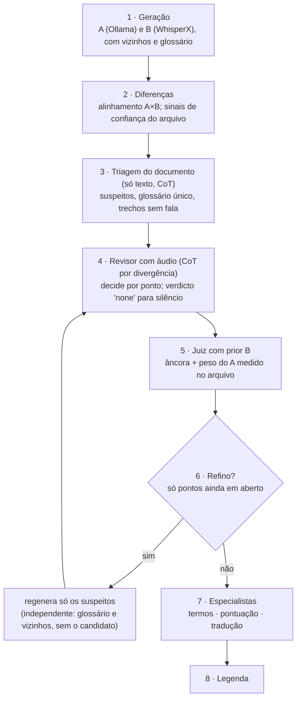

# Plano: pipeline de qualidade v2 (diagnóstico unificado e validação por etapas)

> **Status (2026-11-11): implementado e medido** (v2 e v2.1; resultados e veredito em [experimento-loop-refinamento.md](experimento-loop-refinamento.md)).
> O **modo de qualidade 2** do app é a v2.1 com WhisperX + `gemma4:e4b` + `gemma4:12b`, 2 passadas, modelos fixos. Nasceu do diagnóstico do experimento do filme de 45 min e de duas perguntas do usuário: "por que o pipeline fica pior que o
> WhisperX sozinho?" e "o revisor não deveria ver o texto completo?". Os modos atuais (`quality-e4b`, `quality-12b`) são a **v1** e ficam intactos como linha de base.

## 1. Diagnóstico unificado

Duas camadas de causa, que se somam:

| Camada | Sintoma medido (filme, A e2b + revisor 12b) | Natureza |
|--------|---------------------------------------------|----------|
| **A. Decisão e confiança** | 37 fragmentos em que o WhisperX calou e o A escreveu: **436 dos 849 erros finais** (19 sem fala na legenda original: música/efeito); nos 132 fragmentos em que os dois divergem, o final erra 396 contra 308 do B sozinho; a confiança do revisor é sempre alta (limiares 0,7–0,9 não mudam nada) | lógica do juiz: trata A e B como iguais e silêncio como "falta de texto" |
| **B. Informação** | revisor e geradores veem **um fragmento isolado** (12–28 s): nada de vizinhos, nada de texto completo, nomes escritos de formas diferentes em trechos distantes | falta de contexto |
| **Teto** | melhor escolha possível entre A, B e a mescla = 11,3–11,7 % ≈ B sozinho (11,5 %) | com um A fraco, **selecionar** não melhora; só *corrigir* o B (palavra a palavra, ouvindo) pode |

**Simulação sobre o cache (sem GPU), WER do filme, passada 1:** atual 27,8 % → *B vazio = silêncio* 15,3 % → *+ nunca escolher A* 14,0 % → B sozinho 11,5 %.
**Nos 6 clipes curtos** a regra do silêncio não muda nada (lá o B nunca vem vazio), e "nunca escolher A" ajuda o revisor e4b (6,29 → 4,67 com A e4b) mas piora o par bom e4b + 12b (4,67 → 5,12): **uma regra fixa não serve aos dois casos** (fala limpa × filme).

## 2. Princípios (o que muda na concepção)

1. **O WhisperX é a âncora (prior forte), o A é um desafiante.** A mudança do texto da âncora exige evidência de áudio.
2. **Silêncio é informação.** Quando a âncora calou, o padrão é "sem fala"; o desafiante só vence se o revisor **ouvir fala** (novo veredito `none`/`speech`).
3. **A confiança vem dos dados do arquivo, não do revisor.** Sinais sem referência: razão de palavras A/B (no filme o A escreveu 19 % mais), fração de fragmentos "só A", divergência média, taxa com que o revisor escolhe A. Se o A destoa, perde peso *neste arquivo*.
4. **Decisão local.** O revisor decide **nos pontos de divergência** (alinhamento palavra a palavra de A e B), não escolhe o fragmento inteiro: errar uma palavra custa menos que errar um fragmento.
5. **Contexto sim, âncora não.** O contexto compartilhado (glossário, vizinhos já confirmados) melhora nomes e coerência; o texto candidato do **próprio** fragmento **não** vai ao gerador, para os erros continuarem independentes (é o que faz o portão funcionar; a passada 2 da v1 sofre justamente disso).
6. **Áudio por fragmento, texto por documento.** Os modelos aceitam ~30 s de áudio; o texto completo (~3000 palavras) cabe no contexto. A visão do documento inteiro é uma etapa **só de texto** que aponta suspeitos; quem confirma é sempre o áudio.
7. **Raciocínio em etapas (CoT) com saída estruturada:** o campo `analysis` vem **antes** do veredito no JSON (listar divergências → ouvir → decidir cada uma). Conta como a análise de prompts já prevista.

## 3. Arquitetura proposta

## 4. Mudanças por etapa (cada uma atrás de uma opção, padrão = v1 até validar)

| Etapa | Mudança | Onde |
|-------|---------|------|
| 1 | vizinhos (±2 fragmentos) e glossário no prompt de A e no `initial_prompt` do B; **sem** o candidato do próprio fragmento | `quality_engine._feedback_for`, `prompts/` (`transcribe_context.md`) |
| 2 | alinhamento A×B e lista de divergências; sinais do arquivo (razão A/B, fração só-A, divergência) | `quality_engine`, `metrics` |
| 3 | triagem do documento: prompt de texto com o A e o B completos; saída `{suspects, glossary, no_speech}` | `prompts/document_triage.md`, `OllamaClient.triage` |
| 4 | revisor com `analysis` antes do veredito, decisão por divergência e veredito `none`; vizinhos no prompt | `prompts/review_cot.md`, `OllamaClient.review` (esquema JSON) |
| 5 | juiz com prior B: sem fala quando o B calou (salvo `speech` confirmado); peso do A conforme os sinais | `quality_engine.judge` |
| 6 | refino só dos pontos em aberto, independente; para quando nada muda | `quality_engine.run` |
| 7–8 | como hoje (especialistas e legenda) | — |

Opção de configuração: `quality_judge = "v1" | "v2"` (e, dentro da v2, chaves por etapa para isolar o ganho de cada uma).

## 5. Validação (ablação; só a etapa 4 em diante e o refino usam GPU)

A geração de A e B fica em **cache**: cada variante só refaz triagem, revisão e juiz (~170 fragmentos), então cada rodada é barata.

| Variante | Conteúdo | Roda como |
|----------|----------|-----------|
| V0 | v1 atual (modos `quality-e4b`/`quality-12b`) | já medida |
| V1 | etapa 5 (silêncio + prior B + peso do A) | **repetição offline do cache** (sem GPU) e depois com revisões novas |
| V2 | V1 + vizinhos + glossário (etapa 1) | GPU: regeneração e revisão |
| V3 | V2 + revisor com CoT por divergência e veredito `none` (etapa 4) | GPU: revisões |
| V4 | V3 + triagem do documento (etapa 3) | GPU: triagem + revisões |
| V5 | V4 + refino só dos pontos em aberto (etapa 6) | GPU |

**Conjuntos:** o filme de 45 min (principal) e os 6 clipes curtos (guarda contra regressão). **Métricas:** WER separado em substituições, omissões e inserções; erros por grupo (só A, concordam, divergem); fidelidade pt-BR (juiz cego) e velocidade de leitura; tempo e memória.

**Critérios de aceite da v2:** (a) filme: WER final **≤ WhisperX sozinho** (11,5 %), com inserções abaixo de 2 %; (b) clipes curtos: **não pior** que a v1 (≤ 3,99 % na composição padrão); (c) cada etapa só entra se melhorar a anterior em pelo menos um dos dois conjuntos sem piorar o outro além do ruído; (d) o tempo extra de cada etapa registrado.

## 6. Sequência e dependências

1. **Já (sem GPU):** ferramentas de diagnóstico no repositório (`tools/`), repetição offline da etapa 5, métricas S/D/I e por grupo, testes com dublês.
2. **Com o experimento do filme terminado (GPU livre):** V2 a V5 em ordem, com A e2b/e4b e os dois revisores.
3. **Se o teto continuar baixo:** avaliar outro gerador A (os candidatos registrados em [otimizacoes-futuras.md](otimizacoes-futuras.md) seção 12: Qwen3-Omni, Voxtral, Nemotron Transcribe), porque o teto de seleção depende da qualidade do desafiante.

## 7. Riscos

- **Âncora demais:** com prior B forte o sistema vira "B sozinho" e perde o ganho dos clipes curtos (visto em "só aceita B" = B). Por isso o peso do A é medido no arquivo, não fixo.
- **Cópia de contexto:** vizinhos e glossário que carregam erros do próprio B correlacionam os erros; o uso só de trechos já confirmados e a ausência do candidato mitigam, mas precisa ser medido.
- **CoT custa tempo:** a saída fica mais longa; medir o tempo por fragmento antes de adotar.
- **Triagem em texto pode "alucinar suspeitos":** só o áudio confirma, então a triagem apenas prioriza.
- **Um filme só:** o diagnóstico vem de um filme em inglês; validar com outro gênero/idioma antes de generalizar.

## 8. Decisões do usuário necessárias

1. Adotar o princípio "âncora B + desafiante A" como base da v2?
2. Implementar atrás de opção (`quality_judge`), mantendo a v1 como padrão até validar?
3. Se a v2 passar nos critérios, ela substitui os modos atuais ou entra como terceiro modo?

## 9. Ajuste pedido pelo usuário: o que os geradores recebem na passada de refino, e raciocínio em etapas também neles

**Ordem no tempo.** Na passada 1 os geradores trabalham às cegas (é isso que garante erros independentes) e **não há crítica ainda**: ela só nasce
quando o revisor avalia. Por isso trechos e críticas chegam aos geradores **na passada 2**, e só para os fragmentos em que o revisor mexeu.

**Três níveis de informação nessa passada (variantes a medir, `quality_feedback`):**

| Nível | O que o gerador recebe | Risco |
|-------|------------------------|-------|
| `terms` (v2 atual) | termos e nomes que o revisor ouviu | mínimo: não revela escolha |
| `points` | termos + **os pontos em disputa**, sem veredito ("neste trecho há dúvida entre X e Y: ouça de novo e decida") | baixo: aponta onde ouvir, não diz quem acertou |
| `critique` | `points` + a **crítica do revisor** (o que o revisor ouviu de diferente) | maior: revela a conclusão e pode fazer o gerador copiar; só vale se o ganho compensar |

**Raciocínio em etapas no gerador (passada 2).** Hoje o gerador responde só o texto. Na passada 2 a saída passa a ser JSON com o campo
`analysis` antes do texto (ouvir o trecho de novo, conferir cada ponto em disputa, só então escrever a transcrição). O WhisperX não raciocina:
para ele só entram os termos no `initial_prompt`.

**Tempos.** O fragmento já delimita o trecho no tempo (cerca de 12 s). Apontar o segundo exato da palavra em disputa exige alinhamento por palavra
(o WhisperX tem, mas hoje o desligamos na opção Qualidade): fica como otimização posterior, se a medição mostrar que o fragmento inteiro é grosso demais.

**Como medir:** V3 = `terms`; V3b = `points`; V3c = `critique` (ver seção 5). A comparação mostra se dizer ao gerador onde e o que o revisor ouviu paga o risco de perder independência.
