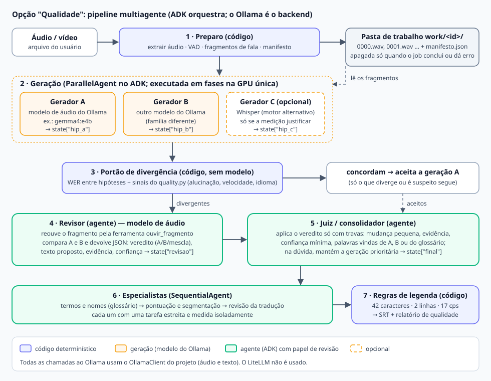
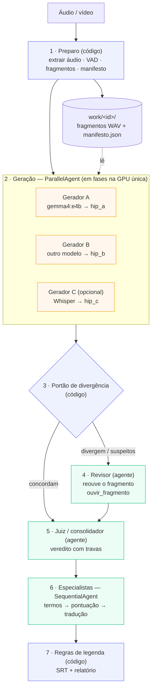
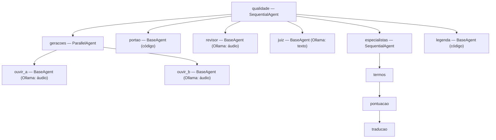
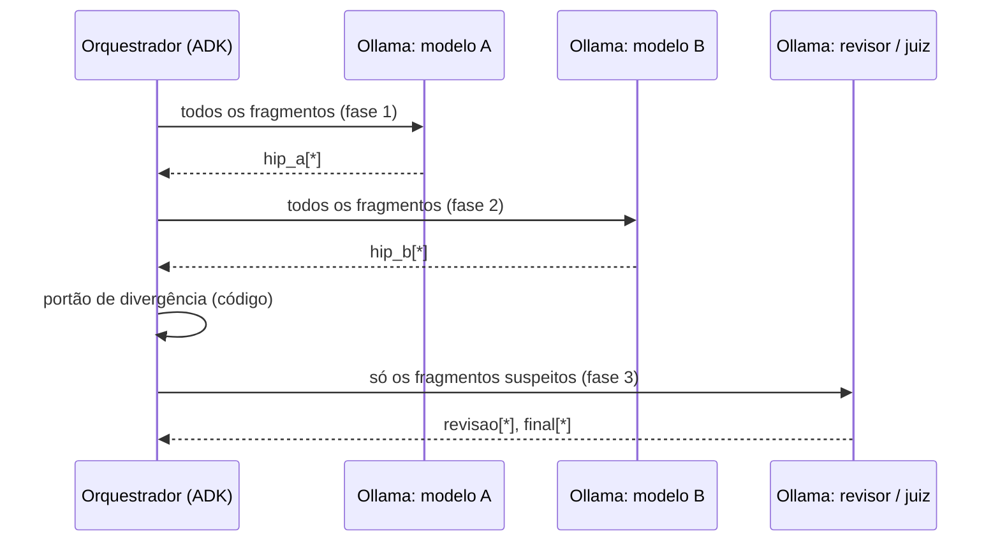

# Proposta multiagente: a opção "Qualidade"

> **Status (2026-11-11): protótipo implementado e validado em fala real** (`transcritor/quality_engine.py`, opção "Qualidade" na lista de motores). A matriz completa
> (geradores × revisores, [modelos.md](modelos.md) seção 7 e [relatorio-avaliacao.md](relatorio-avaliacao.md)) **confirma a ideia com ressalvas**: com a composição certa o WER cai de 4,85 % (melhor gerador
> sozinho, Whisper `turbo`) para **3,99 %** e de 7,87 % (`gemma4:e4b` sozinho) para 3,99 %; o ganho depende de ter **um gerador Whisper** (erros independentes) e **um revisor grande**
> (`gemma4:12b`); revisores pequenos pioram o resultado. **Composição fixada como padrão:** A = modelo de áudio do Ollama (`gemma4:e4b`), B = Whisper `large-v3-turbo`, revisor `gemma4:12b`, limiar 0,05, dúvida → B.
> **Atualização (2026-11-11, noite):** o laço de refinamento, os especialistas (termos, pontuação, revisão da tradução) e a v2 do juiz (âncora no WhisperX, silêncio como informação, decisão por ponto) estão implementados e medidos: ver [experimento-loop-refinamento.md](experimento-loop-refinamento.md) e [plano-pipeline-v2.md](plano-pipeline-v2.md). O app tem agora **dois modos de qualidade com modelos fixos**: o 2 (WhisperX + `e4b` → `12b`) e o 1 (autorrefinamento só com modelos do Ollama: porteiro de fala + `e4b` → `12b`, medido em [experimento-modo1-v2.md](experimento-modo1-v2.md); erra mais que o WhisperX, mas dispensa PyTorch). Os prompts dos agentes ficam em [../prompts/](../prompts/README.md). Falta a camada de orquestração pelo ADK.

## 1. Resumo em um parágrafo

O usuário escolhe entre **rápido** (um único modelo, como hoje) e **Qualidade**. Na opção Qualidade, a arquitetura e os modelos são
**fixos**: dois modelos de áudio do Ollama transcrevem os mesmos fragmentos de áudio; um **portão de divergência** (código) separa o que
concorda do que diverge; um **revisor** (agente com modelo de áudio) reouve os fragmentos duvidosos e escreve um veredito estruturado;
um **juiz** aplica esse veredito com travas contra regressão; **especialistas** ajustam termos, pontuação e tradução; por fim as
regras de legenda geram o SRT e um relatório. O **Google ADK** apenas orquestra; todas as chamadas a modelos passam pelo `OllamaClient`
do projeto, **sem LiteLLM**. Os fragmentos de áudio ficam numa pasta de trabalho e só são apagados quando o trabalho **conclui ou dá erro**.

## 2. Objetivo, escopo e decisões já tomadas

| Decisão | Origem |
|---------|--------|
| A opção Qualidade é **separada** da escolha de motor; arquitetura e modelos são fixos no pipeline | usuário |
| O backend principal é o **Ollama**; modelos Whisper são opcionais e servem de comparação | usuário |
| **Google ADK** para a orquestração; **sem LiteLLM** (o Ollama entra como backend/ferramenta pelo cliente do projeto) | usuário |
| Fragmentos de áudio só são removidos quando o trabalho **conclui ou dá erro** | usuário |
| Nomes de modelos sempre com tag descritiva (nunca `latest`) | usuário |
| O WhisperX e o PyTorch permanecem no projeto | usuário |

Fora do escopo desta proposta: editor de legenda na tela, diarização, debate entre agentes, nuvem.

## 3. Visão geral (diagrama)



Mesma visão em Mermaid (renderiza no GitHub e no VS Code com a extensão de Mermaid):



## 4. Papéis

| # | Etapa | Tipo | Entrada | Saída (estado da sessão) | Modelo |
|---|-------|------|---------|--------------------------|--------|
| 1 | **Preparo** | código | arquivo | fragmentos em `work/<id>/`, `manifest` (início, fim, arquivo) | — |
| 2 | **Gerador A** | geração (Ollama) | fragmento WAV | `hip_a[i]` (texto) | modelo de áudio A (ex.: `gemma4:e4b`) |
| 2 | **Gerador B** | geração (Ollama) | fragmento WAV | `hip_b[i]` | modelo de áudio B, de família diferente |
| 2 | **Gerador C** *(opcional)* | geração (motor Whisper) | fragmento / áudio | `hip_c[i]` com timestamps | Whisper (`large-v3-turbo`) |
| 3 | **Portão de divergência** | código | `hip_*`, sinais do `quality.py` | `suspeitos` (índices) | — |
| 4 | **Revisor** | agente | fragmento + `hip_a`/`hip_b` do suspeito | `revisao[i]` (JSON, seção 6) | modelo de áudio (ouve o fragmento) |
| 5 | **Juiz / consolidador** | agente | `hip_*`, `revisao` | `final[i]` | texto (e áudio só se precisar) |
| 6 | **Especialistas** | agentes em sequência | `final` + glossário do usuário | `final` revisado | texto |
| 7 | **Regras de legenda** | código | `final` + tempos | SRT, `relatorio` | — |

**Nome do papel final.** O agente que "bate o martelo" é o **juiz/árbitro** (*LLM-as-a-Judge*) ou **agregador** (*Mixture-of-Agents*).
Combinar hipóteses de várias fontes é **ROVER** (votação palavra a palavra) ou **correção generativa de erros** (um modelo recebe as
N hipóteses e escreve a melhor); nosso juiz é uma versão disso com travas.

**Por que o revisor precisa ouvir.** Um modelo só de texto julga gramática e plausibilidade, não se a transcrição bate com a fala. Para a
crítica ser *ancorada no áudio*, o revisor é um modelo de áudio do Ollama que reouve o fragmento. Por isso os fragmentos são guardados.

## 5. Como o ADK entra (sem LiteLLM)

O ADK fornece os agentes de fluxo (`SequentialAgent`, `ParallelAgent`, `LoopAgent`) e a sessão com estado compartilhado. Os agentes do
pipeline são classes nossas (`BaseAgent`) que chamam o `OllamaClient` e gravam o resultado em `state` (via `state_delta`):



| Peça do ADK | Uso |
|-------------|-----|
| `SequentialAgent` | ordem das etapas; os especialistas em cadeia |
| `ParallelAgent` | as gerações (mas executadas em fases por causa da GPU única, seção 8) |
| `LoopAgent` | opcional: refinar um fragmento até o revisor aprovar (máx. 2 iterações) |
| `BaseAgent` + `state_delta` | agentes nossos que chamam o `OllamaClient`; sem LLM do ADK |
| Estado da sessão | `hip_a`, `hip_b`, `hip_c`, `suspeitos`, `revisao`, `final`, `relatorio` |

**Por que sem LiteLLM.** O LiteLLM é uma dependência a mais e, nos nossos testes, **não passa áudio** ao Ollama pelo ADK (o caminho
nativo `ollama_chat/` e o `audio_url` do ADK falham; só a rota `/v1` aceita `input_audio` quando chamada direto). O `OllamaClient` já
envia áudio no formato certo do Ollama. A prova de conceito está em `tools/adk_ollama_agents_probe.py`.

## 6. Contratos (para impedir que o revisor "corrija" o que estava certo)

**Saída do revisor (JSON, uma por fragmento suspeito):**

```json
{
  "fragmento": 7,
  "veredito": "B",
  "texto": "Segundo o Dr. Moll, alguns pacientes podem ter contraído o vírus no hospital.",
  "mudancas": [{"de": "maw", "para": "Moll", "evidencia": "ouvi 'Moll' em 0:03"}],
  "confianca": 0.82
}
```

`veredito` ∈ {`A`, `B`, `mescla`, `nenhum`}. A resposta é validada por esquema (o Ollama aceita saída em JSON Schema).

**Travas do juiz (todas precisam passar para aceitar a mudança):**

| Trava | Regra |
|-------|-------|
| Tamanho da mudança | no máximo ~20 % das palavras do fragmento mudam; nunca reescrever o fragmento |
| Evidência | cada mudança cita a palavra e o instante ouvido |
| Confiança mínima | `confianca` ≥ limiar (ajustado na avaliação) |
| Origem das palavras | o texto final só usa palavras de A, de B ou do glossário do usuário |
| Dúvida | se alguma trava falhar, **mantém a geração prioritária (A)** e registra no relatório |

## 7. Fragmentos e pasta de trabalho

```
work/<id>/
├── manifesto.json        início, fim, arquivo, hip_a, hip_b, suspeito, revisao, final (por fragmento)
├── 0000.wav  0001.wav …  fragmentos de fala (16 kHz, mono)
└── relatorio.json        decisões do juiz, avisos, tempos por etapa
```

```mermaid
stateDiagram-v2
    [*] --> Criada: preparo cria work/id
    Criada --> EmUso: gerações, revisão, juiz
    EmUso --> EmUso: retomada após interrupção
    EmUso --> Apagada: trabalho concluído
    EmUso --> Apagada: trabalho com erro
    EmUso --> Apagada: cancelado (sugestão; opção "manter" para análise)
    Apagada --> [*]
```

- **Regra do usuário:** a pasta só é apagada quando o trabalho conclui ou dá erro. **Em aberto:** cancelamento (sugestão: apagar, com opção de manter para análise).
- **Tamanho:** ~2 MB por minuto de áudio (16 kHz mono 16 bits); 3 horas ≈ 350 MB. No modo servidor, uma pasta por usuário, dentro do TTL já existente.
- **Retomada:** o manifesto permite continuar de onde parou e refazer só um fragmento ruim.

## 8. Execução em GPU única

Chamar dois modelos diferentes alternadamente obriga o Ollama a descarregar e carregar modelos (segundos por troca). Por isso a geração roda **em fases**:



Medido nesta máquina (Intel Arc Pro B60, 23,8 GiB): `gemma4:e4b` ≈ 45x o tempo real; `gemma4:e2b` parecido; `nemotron-bolt` ≈ 7x mais lento; **`gemma4:12b` é inviável** (roda quase todo na CPU: 190–435 s por clipe).
O paralelismo (`parallel`) **não** acelerou o Ollama nesta GPU. A opção Qualidade custa, no mínimo, **o dobro do tempo** da rápida.

## 9. Medição do sucesso

Avaliação com `tools/evaluate.py` e `tools/quality_probe.py` sobre o mesmo conjunto de referência:

| Métrica | Como | Critério sugerido para continuar |
|---------|------|----------------------------------|
| Ganho de WER | WER do pipeline × WER do gerador A sozinho (fala real) | ≥ 1 ponto percentual absoluto |
| Regressão | fragmentos em que o juiz piorou o texto | ≈ 0 (qualquer piora é bug) |
| Custo | RTF do pipeline × RTF rápido | ≤ 3x |
| Cobertura do portão | fragmentos com erro que o portão marcou | ≥ 50 % |

## 10. Evidências de viabilidade (2026-11-11)

**Material:** voz sintética (7 clipes) e **fala real** do conjunto público FLEURS PT-BR (3 clipes, ~14 min, 66 falas, 1491 palavras). WER com números por extenso.

| Pergunta | Resultado |
|----------|-----------|
| O ADK conversa com o Ollama? | Sim (via LiteLLM): texto, chamada de ferramenta e ferramenta de áudio própria funcionam; áudio nativo pelo ADK falha |
| Agentes nossos sobre o Ollama, sem LiteLLM? | Prova de conceito em `tools/adk_ollama_agents_probe.py` |
| Duas gerações e portão, em fala sintética | Baseline ~2 %; revisor perfeito → 1,6–1,9 %; portão marca 10–20 % dos fragmentos com erro |
| Em **fala real** | Baseline (`gemma4:e4b`) **~6 %**; revisor perfeito → **5,1 %** (com `e2b`), 5,8 % (`bolt`), 5,3 % (`lfm3`); portão com `e2b` → 5,6 %; `e2b` erra 12,3 %, `bolt` 6,6 %, `lfm3` 69 % |
| De que são os erros? | Sobretudo **nomes próprios e termos raros** (Moll, Gangetica, Vinson, Klocker Ehrenstrahl, sigla NSW), que modelos parecidos erram **juntos** |

**Leitura:** o teto de ganho de um revisor perfeito é pequeno (0,2–0,9 ponto percentual) e o portão recupera menos da metade disso.
A parte do pipeline que mais atacaria os erros observados é o **glossário/contexto** (nomes) e, secundariamente, outro motor com
vocabulário diferente. **Descoberta colateral:** passar um texto em português por um modelo para "traduzir" para português **dobrava o WER**
(11 % → 5–7 % depois de pular a tradução quando o idioma já é o de saída, e ~45 % mais rápido); isso já foi corrigido no pipeline.

Riscos conhecidos: tempo (2x ou mais), memória da GPU ao alternar modelos, calibragem das travas, dependência do `google-adk` (pesada; manter fora do executável leve).

### Resultado da matriz de geradores × revisores (fala real, 6 clipes)

| Configuração | WER | RTF |
|--------------|-----|-----|
| Whisper `turbo` sozinho (melhor isolado) | 4,85 % | 0,05 |
| `gemma4:e4b` sozinho | 7,87 % | 0,05 |
| `e4b` + Whisper `turbo`, revisor `e4b` | 5,47 % | 0,12 |
| `e4b` + Whisper `turbo`, revisor nemotron | 4,50 % | 0,13 |
| **`e4b` + Whisper `turbo`, revisor `12b`** | **3,99 %** | 0,15 |

O revisor grande é decisivo (revisores pequenos pioram). O teto (revisor perfeito) é 3,4 %: o `12b` captura ~60 % do ganho possível. Detalhes em [relatorio-avaliacao.md](relatorio-avaliacao.md).

## 11. Variantes

| Variante | Conteúdo | Custo | Recomendação |
|----------|----------|-------|--------------|
| **Leve** | Gerador único + **glossário** (nomes) + especialistas de pontuação/tradução + relatório; sem 2ª geração | ~1,2x | **começar por aqui** |
| **Completa** (recomendada, implementada no protótipo) | A (Ollama) + B (Whisper `turbo`) + portão + revisor `12b` + juiz; especialistas ainda por fazer | ~3x o Whisper sozinho | **sim**, validada em fala real |
| **Com Whisper como 3ª geração** | Completa + gerador C | maior | **descartada**: o usuário definiu **2 geradores** por pipeline; o Whisper é o B |

## 12. Plano de implementação

1. **Pasta de trabalho e manifesto** (não usa GPU): fragmentos em WAV, texto por geração, decisões; limpeza só em concluído/erro.
2. **Glossário/contexto robusto** e especialistas de pontuação e tradução (variante leve), medidos com fala real.
3. **Portão de divergência e relatório** (código), já com `metrics.divergence` e `quality.py`.
4. **Agentes ADK** (`BaseAgent`) para geração, revisor e juiz; testes com dublês do `OllamaClient`.
5. **Avaliação com fala real** de cada etapa (seção 9); decidir se a variante completa entra.
6. **Whisper como Gerador C**, se justificado.

Critérios de aceite de cada etapa: testes automáticos com dublês, documentação atualizada, métricas da seção 9 registradas em `docs/modelos.md`.

## 13. Questões em aberto

- Cancelar apaga a pasta de trabalho? (sugestão: sim, com opção de manter)
- Qual par de modelos para A e B, se a variante completa for adiante? (hoje, `gemma4:e4b` × `gemma4:e2b`; o `e2b` é rápido mas pior em fala real)
- Limiares do portão e das travas (calibrar com a avaliação).
- Onde instalar o `google-adk` (ambiente separado do executável leve).

## 14. Arquivos relacionados

- Ferramentas: `tools/quality_probe.py` (sonda de divergência), `tools/adk_probe.py` (compatibilidade ADK + Ollama + áudio), `tools/adk_ollama_agents_probe.py` (agentes ADK sobre o Ollama, sem LiteLLM), `tools/evaluate.py`.
- Código existente reaproveitado: `transcritor/quality.py` (alucinações/emendas), `transcritor/metrics.py` (WER, divergência, análise do portão), `transcritor/srt.py` (regras de legenda), `transcritor/ollama_client.py`.
- Resultados: [modelos.md](modelos.md) seção 6; roteiro: [avaliacao.md](avaliacao.md); roadmap: [otimizacoes-futuras.md](otimizacoes-futuras.md) seção 11.
